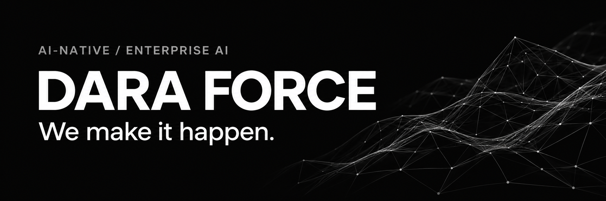

  <strong>OpenAI Partner Network</strong> · <a href="https://www.daraforce.com/">daraforce.com</a>

---

## Sobre Dara Force

Somos una empresa argentina nativa en inteligencia artificial. Diseñamos e integramos agentes, asistentes y automatizaciones que conectan modelos de IA con APIs, bases de datos y sistemas empresariales.

Dara Force forma parte de **OpenAI Partner Network**.

## Qué vas a encontrar en este perfil

Este es nuestro espacio en GitHub para compartir herramientas y ejemplos de ingeniería aplicada a la inteligencia artificial.

- **Skills y herramientas** para asistentes y agentes de IA.
- **Ejemplos reproducibles** de integración con APIs, servidores MCP y flujos de automatización.
- **Prototipos y referencias técnicas** para probar ideas y adaptarlas a tus propios proyectos.

Cada publicación incluirá instrucciones de uso y su licencia. El código propio que publiquemos como código abierto se distribuirá bajo licencia MIT.

## Leonardo Condorí

Fundador de Dara Force. Combino desarrollo de software, divulgación tecnológica y trabajo con comunidades de desarrolladores. Mi objetivo es explicar la tecnología para que más personas puedan usarla.

[leocondori.com](https://leocondori.com/)
